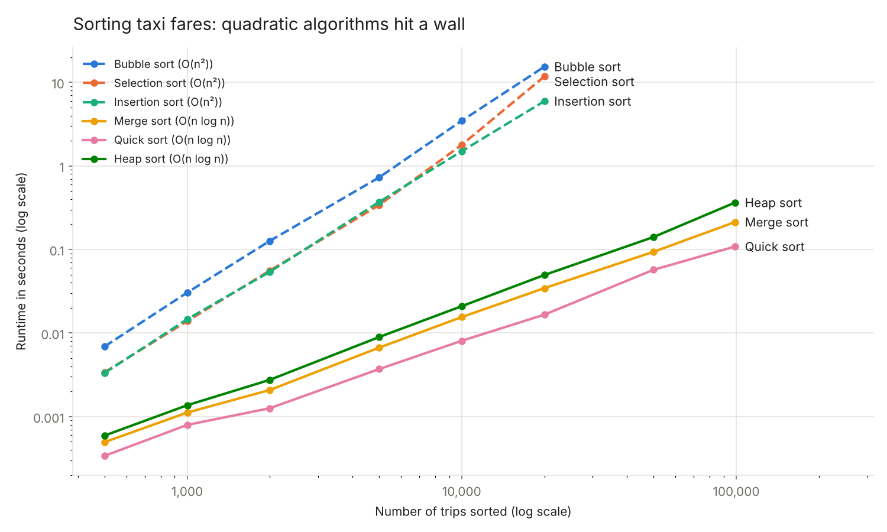
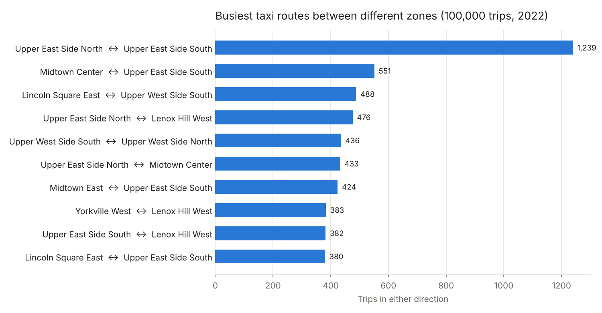

# How much does algorithmic complexity matter on real data?

**Six sorting algorithms and three graph searches, written from scratch and benchmarked on 100,000 NYC taxi trips.**



> **TL;DR**
> - At 20,000 trips, bubble sort takes **15 seconds**; quick sort takes **0.017**. Extrapolated to the full 100,000 trips, bubble sort would need about **6 minutes**, quick sort **0.1 seconds**.
> - Big-O isn't the whole story: on **already-sorted** input, bubble and insertion sort beat every O(n log n) algorithm, and quick sort runs **8× faster** on data with few distinct values.
> - In the trip network, zones that look **isolated in a 5,000-trip sample disappear at 100,000 trips**: every zone turns out to be connected. Small samples can invent structure.

**Stack:** Python (standard library for all algorithms) · NetworkX (validation only) · pandas and matplotlib (reporting) · pytest

---

## Data

A sample of **100,000 yellow-taxi trips from 2022**, from the public [NYC TLC Trip Record Data](https://www.nyc.gov/site/tlc/about/tlc-trip-record-data.page), plus 5,000- and 30,000-trip subsets and the TLC zone lookup table (`data/`).

Raw trip data needs checking before use. Out of 100,000 records:

| Issue | Records | Treatment |
|---|---|---|
| Missing passenger count | 3,447 | excluded from passenger stats |
| Negative fare (refunds, corrections) | 613 | excluded from money stats |
| Drop-off at or before pickup | 78 | excluded from speed and duration |
| Average trip speed above 100 km/h | 133 | excluded from speed stats |

After cleaning, the typical trip carries 1.4 passengers, costs **$21.72** in total (fare $14.88, tip $2.72) and averages **19 km/h** door to door. JFK Airport alone accounts for 4,709 pickups, nearly 5% of the sample.

## Sorting: theory vs stopwatch

The six algorithms in `src/sorting.py` (bubble, selection, insertion, merge, quick, heap) sort trip totals at sizes from 500 to 99,000. Each timing is the median of several runs, and every algorithm is checked against Python's `sorted()` in `tests/`.

| Trips | Bubble | Selection | Insertion | Merge | Quick | Heap |
|---:|---:|---:|---:|---:|---:|---:|
| 1,000 | 0.031 s | 0.014 s | 0.015 s | 0.001 s | 0.001 s | 0.001 s |
| 10,000 | 3.47 s | 1.78 s | 1.50 s | 0.016 s | 0.008 s | 0.021 s |
| 20,000 | 15.4 s | 11.7 s | 5.95 s | 0.034 s | 0.017 s | 0.050 s |
| 99,000 | — | — | — | 0.213 s | 0.109 s | 0.364 s |

Doubling the input from 10,000 to 20,000 multiplies bubble sort's runtime by about 4, the signature of O(n²). Merge sort's only doubles.

**Does the shape of the data change the winner?** Same size (10,000 values), three kinds of input:

| Input | Bubble | Insertion | Quick | Merge |
|---|---:|---:|---:|---:|
| Random fares | 3.38 s | 1.52 s | 0.008 s | 0.016 s |
| Passenger counts (7 distinct values) | 2.62 s | 0.61 s | **0.001 s** | 0.012 s |
| Already sorted | **0.0005 s** | **0.0007 s** | 0.005 s | 0.009 s |

Bubble sort with an early exit and insertion sort run in linear time on sorted input. Quick sort's three-way split groups equal values in one pass, so data with few distinct values is close to its best case.

## The trip network

Each taxi zone is a node, and each pair of zones with at least one trip between them is an edge weighted by the number of trips. `src/graph.py` finds connected components with its own DFS and BFS, both checked against NetworkX.

| Sample | Zones | Routes | Connected components |
|---:|---:|---:|---|
| 5,000 trips | 184 | 1,626 | 3 (181 + 2 + 1 zones) |
| 30,000 trips | 240 | 3,326 | 3 (236 + 2 + 2) |
| 100,000 trips | 253 | 5,234 | **1** (all 253) |

The "isolated" zones in the small samples were a sampling artefact, not a feature of the city. On a graph this size, all three searches finish in about 0.2 milliseconds.



The busiest route by far runs between the two halves of the Upper East Side (1,239 trips), and nine of the top ten routes stay within Manhattan's Upper East Side, Upper West Side and Midtown.

## Limitations

- Timings come from pure-Python implementations on one machine. Absolute numbers will differ elsewhere; the ratios and growth rates are the point.
- Quadratic algorithms were stopped at 20,000 trips. The 100,000-trip figures for them are extrapolations.
- The 100,000 trips are a sample of 2022, so route rankings are estimates, not the full-year picture.

## Run it yourself

```bash
pip install -r requirements.txt
pytest                      # 43 correctness tests
python benchmark.py         # regenerates results/ and the runtime chart (~3 minutes)
python plot_routes.py       # regenerates the routes chart
jupyter notebook analysis.ipynb
```

```
├── src/
│   ├── taxi_data.py     loading, cleaning, trip statistics
│   ├── sorting.py       six sorting algorithms
│   └── graph.py         trip graph, DFS and BFS components
├── tests/               correctness tests (pytest)
├── data/                trip samples and zone lookup
├── results/             benchmark outputs (CSV)
├── images/              charts used in this README
├── analysis.ipynb       full walkthrough with outputs
├── benchmark.py
└── plot_routes.py
```

---

<sub>Rebuilt from a group project for the Algorithms course at LUISS Guido Carli (May 2024).</sub>
